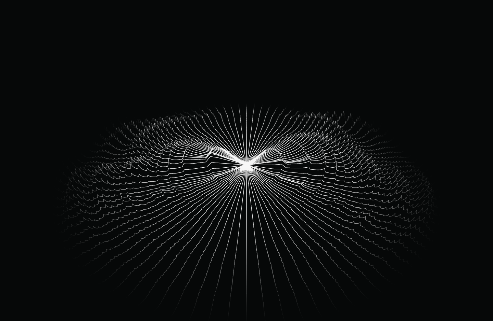

# Wave History

Трёхмерная история звука на Three.js. Аудио превращается в непрерывные волны: новый спектр формируется в центре, история расходится наружу и плавно исчезает.

[Открыть в браузере](https://aiaa.pro/wave-history/) · [Скачать Windows EXE](https://github.com/antonstrobe/wave-history/releases/latest/download/Wave.History.Portable.exe) · [Пример со звуком](https://aiaa.pro/wave-history/example.html)



## В браузере

1. Откройте Wave History в Chrome или Edge на компьютере.
2. В соседней вкладке запустите музыку, видео или [тестовый звук](https://aiaa.pro/wave-history/example.html).
3. Нажмите «Захват выключен», выберите вкладку со звуком и включите передачу её аудио.
4. Выберите понравившийся вид, вращайте сцену мышью или включите полный экран.

Для звука всего компьютера выберите экран и передачу системного аудио, если браузер предлагает этот вариант. Доступность зависит от браузера и ОС. Браузер каждый раз запрашивает разрешение и выбор источника. На мобильных устройствах захват вкладки может быть недоступен, при этом демонстрация работает без разрешений.

«Демо» показывает синтетические волны без звука. Страница `example.html` создаёт настоящий тестовый аудиосигнал после нажатия кнопки; основная страница захватывает его из соседней вкладки и анализирует тем же AudioWorklet, что и музыку.

Аудио обрабатывается локально. Запись и отправка аудио или экрана не ведутся. Видеотрек, обязательный для браузерного выбора источника, отключён и не используется. При остановке захвата все треки закрываются.

## На ПК

Скачайте `Wave.History.Portable.exe` из [Releases](https://github.com/antonstrobe/wave-history/releases). Windows x64, установка и Node.js не нужны. Рядом с EXE создаётся папка `Wave History Data` с настройками. Для переноса профиля берите её вместе с программой.

Нажмите «Захват выключен»: приложение использует системный звук устройства воспроизведения Windows по умолчанию. После смены выхода Windows переподключите захват.

Собственные EXE подписаны издателем `okronoom`. Сертификат самоподписанный с локальным доверием: на другом ПК доверие и отсутствие предупреждений Windows не гарантируются. Сторонние файлы Electron сохраняют исходные подписи.

## Виды и управление

Доступны семь вариантов: «Круговые волны», «Звук из центра», «Исходная лента», «Прозрачные волны», «Стереозеркало», «Мягкий холм», «Полёт над горами». Выбор и ручные настройки эффектов запоминаются.

В круговом режиме «Волны» соединяют срезы непрерывными линиями. «Кольца» показывают контуры. Центрального индикатора нет: бас входит в общий рельеф и уходит вместе с историей.

- ЛКМ: вращение. ПКМ или Shift + ЛКМ: перемещение. Колесо: масштаб к указателю.
- Двойной щелчок: сброс камеры. Стрелки при фокусе на сцене: перемещение.
- F11: только визуализация на весь экран. Escape: вернуть интерфейс. H: скрыть интерфейс в текущем окне.
- Пробел: пауза. Возобновление начинает новую непрерывную историю.
- Чёрная поверхность и её прозрачность, лёгкая асимметрия, затухание, цвета, горы и полёт включаются отдельно.

Один срез каждые 50 мс по умолчанию, история 12 секунд. Интервал регулируется от 25 до 100 мс. Стереоканалы анализируются отдельно. Сформированные волны сохраняют рисунок при движении; затухание меняет прозрачность. 50 мс является шагом измерения, полная задержка также включает окно FFT 4096 отсчётов и задержку устройства.

## Запуск из исходников

Node.js 22.12 или новее. Зависимости закреплены в `package-lock.json`.

```sh
npm ci
npm run build:web
npm run preview:web
```

Браузерная версия откроется по адресу `http://127.0.0.1:8077/`. Остановить локальный сервер: Ctrl+C. Для публикации скопируйте содержимое `web-dist` на HTTPS-хостинг. Открытие HTML через `file://` не подходит для захвата аудио и AudioWorklet.

Отдельное окно приложения из исходников:

```sh
npm run dev
```

Разработка не требует сертификата подписи. Системный loopback и портативная сборка проверены на Windows; macOS и Linux не проверялись.

## Сборка Windows и проверки

```sh
npm test
npm run build
npm run test:app
npm run test:effects
npm run test:radial
npm run build:web
npm run test:web
npm run build:portable
npm run test:portable
```

`test:web` запускает отдельный тестовый Chrome и проверяет настоящий захват аудио из вкладки примера, шаг 50 мс, полноэкранный режим и мобильную раскладку. Его автоматический выбор источника действует только в тестовом браузере. Обычная опубликованная страница всегда показывает стандартный диалог выбора.

`build` и `build:portable` используют внешний Windows-инструмент подписи. Путь можно задать через переменную `WAVE_SIGNING_SCRIPT`; скрипт должен принимать `-Path` и использовать сертификат текущего пользователя. Выпуск проверяет `Valid` и `CN=okronoom`. Ключ и сертификат с закрытым ключом в репозиторий не входят. Для обычного запуска используйте готовый EXE или `npm run dev`.

## Архитектура

- `src/dsp.js`, `src/audio-worklet.js`: FFT, две стереодорожки, расписание по аудиоотсчётам.
- `src/shape.js`, `src/terrain.js`: формирование и движение волн, Three.js и управление камерой.
- `src/app.js`, `src/presets.js`: захват, интерфейс, история и варианты визуализации.
- `web/example.html`, `web/example.js`: вкладка с тестовым звуком.
- `main.cjs`: отдельное окно Electron с системным loopback Windows.

Технические контракты и проверки: [DEVELOPMENT.md](DEVELOPMENT.md). Three.js распространяется по MIT; браузерная сборка включает текст его лицензии. Electron содержит собственные уведомления о сторонних компонентах.

## API и ограничения

[MDN: getDisplayMedia](https://developer.mozilla.org/en-US/docs/Web/API/MediaDevices/getDisplayMedia) · [Chrome: выбор источника и системного аудио](https://developer.chrome.com/docs/web-platform/screen-sharing-controls) · [Electron: desktopCapturer](https://www.electronjs.org/docs/latest/api/desktop-capturer)
